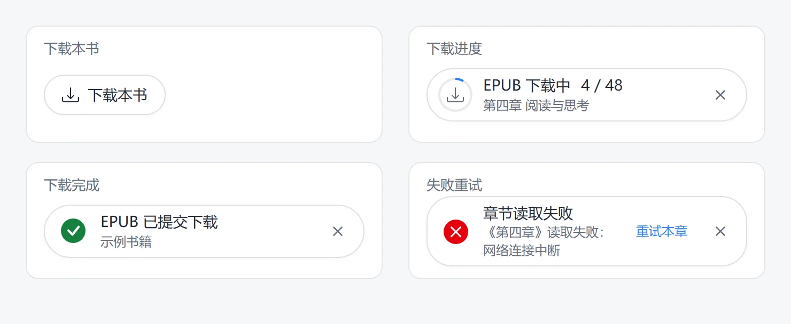

<p align="center">
  
</p>

<h1 align="center">WeRead Downloader</h1>

<p align="center">
  <strong>Automatically detect the book format on WeRead and export EPUB, TXT, or the original PDF provided by the platform with one click.</strong>
</p>

<p align="center">
  
  
  <a href="LICENSE"></a>
</p>

<p align="center"><a href="README.md">简体中文</a> · English</p>

## Features

- Detects the book format: EPUB, TXT, or the original PDF when available.
- Shows progress, supports cancellation, chapter retries, missing-image retries, and repaired EPUB exports.
- Keeps a local download history. Click “重新下载” (Download again) to export another copy.

<p align="center">
  
</p>

## Installation and usage

Requires **Chrome 116+**. Install the prebuilt extension directly; no Node.js installation or local development server is needed.

1. Go to [Releases](https://github.com/churjan/weread-downloader/releases) and download the extension ZIP package from the release assets. Do not download the **Source code** archive.
2. Extract the package to a permanent folder and keep that folder in place.
3. Open `chrome://extensions/`, enable **Developer mode** in the upper right, click **Load unpacked**, and select the extracted folder containing `manifest.json`.
4. Sign in to [WeRead](https://weread.qq.com/), open a book, and click “下载本书” (Download this book) at the bottom right of the reading page.

To update, download the new package and extract it over the existing extension folder. Click **Reload** on the extensions page, then refresh the reading page.

## Notes

- Keep the reading tab open during export. Available content depends on your account's reading access and the resources provided by WeRead.
- EPUB exports include a table of contents, cover, and inline images. Missing images, missing styles, and unsupported resources are reported.
- Ordinary success messages close after five seconds. Warnings and errors stay visible for review and retries.
- Download history stays in the extension's local browser storage. You can download again after deleting a file.

## Development

Built with WXT, TypeScript, and fflate.

Development and source builds require **Node.js 22.12+**. Download the source, then run these commands in the project folder:

```sh
npm ci                # Install dependencies
npm run dev           # Development mode
npm run check         # Type checking
npm test              # Unit tests
npm run test:browser  # Browser checks with controlled fixtures
npm run build         # Build the extension
```

After building, use **Load unpacked** on the extensions page and select `.output/chrome-mv3`.

Browser checks require a local Chrome / Edge installation. Set `CHROME_PATH` to use a specific executable.

## License

[MIT](LICENSE) · [Third-party notices](THIRD_PARTY_NOTICES.md)
