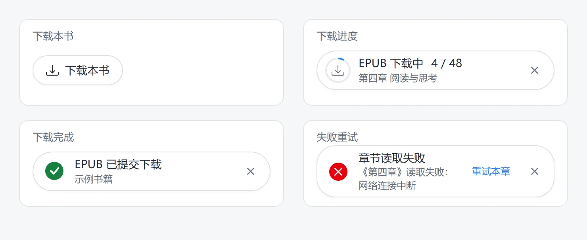

<p align="center">
  
</p>

<h1 align="center">微信读书下载</h1>

<p align="center">
  <strong>微信读书网页版导出插件，自动识别书籍格式，一键导出 EPUB、TXT 或平台提供的原版 PDF。</strong>
</p>

<p align="center">
  
  
  <a href="LICENSE"></a>
</p>

<p align="center">简体中文 · <a href="README-en.md">English</a></p>

## 功能

- 自动识别格式，支持 EPUB、TXT，以及平台提供的原版 PDF。
- 显示下载进度，支持取消、章节重试、缺图重试和另存修复版 EPUB。
- 本地保存下载记录，点击“重新下载”即可再次导出。

<p align="center">
  
</p>

## 安装与使用

需要 **Chrome 116+**。直接安装打包好的插件即可使用，无需安装 Node.js 或在本地运行项目。

1. 前往 [Releases](https://github.com/churjan/weread-downloader/releases)，下载发布附件中的插件 ZIP 安装包，请勿选择 **Source code** 源码包。
2. 将安装包解压到固定目录，保留解压后的文件夹。
3. 打开 `chrome://extensions/`，开启右上角的“开发者模式”，点击“加载已解压的扩展程序”，选择解压后包含 `manifest.json` 的文件夹。
4. 登录 [微信读书](https://weread.qq.com/)，打开书籍，点击阅读页右下角的“下载本书”。

更新时，下载新版安装包并解压覆盖原插件目录，再到扩展管理页点击“重新加载”，最后刷新阅读页。

## 注意事项

- 导出时保持阅读页打开；可下载内容取决于账号的阅读权限和平台提供的资源。
- EPUB 包含目录、封面和正文插图；缺图、样式缺失或不支持的资源会显示提示。
- 普通成功提示会在 5 秒后收起；有警告或失败时保留提示，方便查看和重试。
- 下载记录只保存在当前浏览器的扩展本地存储中。删除文件后，仍可点击“重新下载”。

## 开发

基于 WXT、TypeScript 和 fflate。

开发或自行构建需要 **Node.js 22.12+**。下载源码后，在项目目录执行：

```sh
npm ci                # 安装依赖
npm run dev           # 开发模式
npm run check         # 类型检查
npm test              # 单元测试
npm run test:browser  # 受控浏览器产物检查
npm run build         # 构建扩展
```

自行构建后，在扩展管理页通过“加载已解压的扩展程序”选择 `.output/chrome-mv3`。

浏览器检查需要本机 Chrome / Edge，也可通过 `CHROME_PATH` 指定路径。

## 许可

[MIT](LICENSE) · [第三方声明](THIRD_PARTY_NOTICES.md)
